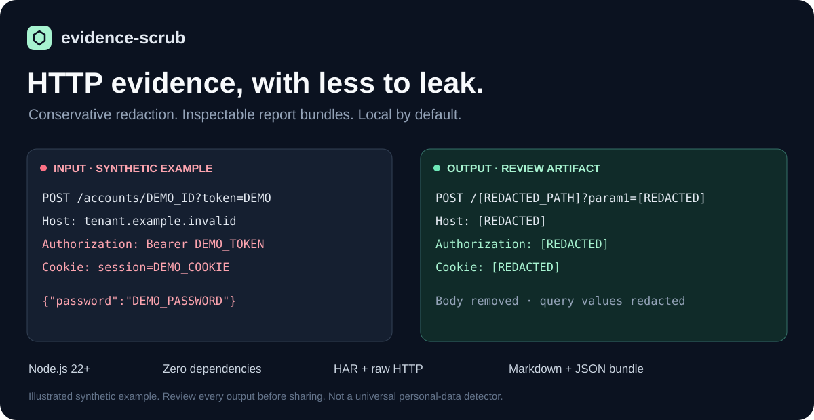

# evidence-scrub

Turn a HAR capture or raw HTTP message into an inspectable evidence bundle.

**Local by default. No package dependencies. Conservative redaction.**



[Português do Brasil](README.pt-BR.md) · [Security](SECURITY.md) · [Contributing](CONTRIBUTING.md)

Preparing a bug report often means separating useful protocol details from credentials, bodies, and identifying URLs. `evidence-scrub` creates a redacted capture, a readable Markdown report, and a machine-readable summary in one directory.

Review every output before sharing it. This is a redaction aid, not a complete personal-data detector or a guarantee that a capture is safe to publish.

## Quick start

Requires **Node.js 22 or later**. Run directly from the repository; no `npm install` is needed.

```sh
git clone https://github.com/GabrielGomesAL/evidence-scrub.git
cd evidence-scrub
node bin/evidence-scrub.mjs fixtures/demo.har --out ./clean-demo
```

The included fixture is entirely synthetic. Open `clean-demo/report.md` and inspect the accompanying files.

For your own capture, choose a new output directory in a private location:

```sh
node bin/evidence-scrub.mjs /private/capture.har --out /private/review-bundle
```

The output directory must not already exist. The original input remains unchanged.

## A small example

Synthetic input:

```http
GET https://service.example.invalid/accounts/alice?token=synthetic-token HTTP/1.1
Authorization: Bearer synthetic-secret
Content-Type: application/json

{"private":"synthetic"}
```

Redacted HTTP output:

```http
GET https://redacted.invalid/[REDACTED_PATH]?param1=[REDACTED] HTTP/1.1
authorization: [REDACTED]
content-type: application/json
```

The body is removed. The generated report also includes transformation counts, source provenance, and a finding draft for you to complete.

Explore the [complete synthetic example bundle](docs/example-bundle/report.md).

## What you get

| File | Purpose |
| --- | --- |
| `sanitized.har` or `sanitized.http` | Redacted copy in the detected input format |
| `report.md` | Human-readable evidence report |
| `summary.json` | Structured summary for your own tooling |
| `github.json` | Public repository metadata, only when `--github` is supplied |

The report identifies the source by its SHA-256 digest, without including the source filename or filesystem path. The digest links the report to the exact input bytes; it does not establish the capture's origin or authenticity.

## Redaction policy

The output is rebuilt from a conservative set of supported fields. Unknown capture fields are omitted rather than copied through.

| Data | Default handling |
| --- | --- |
| Origin of an absolute URL | Replaced with `https://redacted.invalid`; relative HTTP targets remain relative |
| URL path | Replaced with `/[REDACTED_PATH]`; the root `/` may remain |
| Query keys, query values, and fragments | Redacted |
| Request and response bodies | Removed |
| Cookies | HAR cookie arrays removed; cookie header values redacted |
| Header values | Redacted, except recognized MIME values in `Content-Type` |
| Header names | Known names retained; unknown names discarded |
| Supported methods, statuses, and timestamps | Retained or normalized |
| Supported numeric protocol statistics | Retained |

The output is a **review projection, not a replayable request or an unmodified transcript**. Removed body sizes become `0`, unknown header sizes become `-1`, unsupported methods become `OTHER`, unsupported versions become empty, and invalid status/timing values use `0` or `-1` placeholders. Missing or invalid HAR timestamps are rejected. These normalized fields describe the transformed artifact; do not present them as unmodified evidence from the source.

### Keep paths when they are needed

Route structure can matter when explaining a bug. `--keep-paths` preserves the URL pathname while keeping the other URL redactions:

```sh
node bin/evidence-scrub.mjs fixtures/demo.har --out ./clean-paths --keep-paths
```

Paths can contain account names, record IDs, email addresses, or tokens. Only enable this option when you have inspected them and intend to retain them.

### Raw HTTP

HAR and raw HTTP are detected from the input. The HTTP parser handles one request or one response, rather than a concatenated conversation:

```sh
node bin/evidence-scrub.mjs /private/request.http --out /private/http-review
```

Use `--format har` or `--format http` to select the parser explicitly. Run `node bin/evidence-scrub.mjs --help` for all options.

### Optional GitHub context

Attach public metadata for a repository to the same bundle:

```sh
node bin/evidence-scrub.mjs fixtures/demo.har --out ./clean-context --github pydantic/pydantic
```

This option contacts the public GitHub API for the repository you specify and the commit SHA of its default branch. It sends the repository's owner/name, not your capture or generated evidence. No GitHub token is required. GitHub availability and rate limits can affect this optional lookup. The metadata records a public revision; it does not prove that your capture came from that revision.

Without `--github`, processing stays local.

## Limits and review

- Input files are limited to **20 MiB**. Additional parser limits apply to HTTP text, entry counts, headers, and field sizes; malformed or oversized structures are rejected.
- Supported metadata may still contain sensitive information. Review the redacted capture, report, summary, and optional repository metadata before sharing them.
- `--keep-paths` deliberately retains more information.
- Keep original captures private. Use synthetic examples when reporting a problem with this tool.
- A generated bundle is a starting point for human review, not an authorization to disclose evidence.

## Development

```sh
node --test
```

CI runs the tests on Node.js 22 and 24 with read-only repository permissions. No dependency installation is needed.

Useful contributions include synthetic regression fixtures, parser edge cases, clearer reports, and improvements to redaction behavior. See [CONTRIBUTING.md](CONTRIBUTING.md).

## License and support

[MIT](LICENSE) · Gabriel Gomes Almeida

For ordinary bugs, open an issue with a synthetic reproduction. For a security issue, follow [SECURITY.md](SECURITY.md) and contact **ggoalmeidaa@gmail.com** privately.
