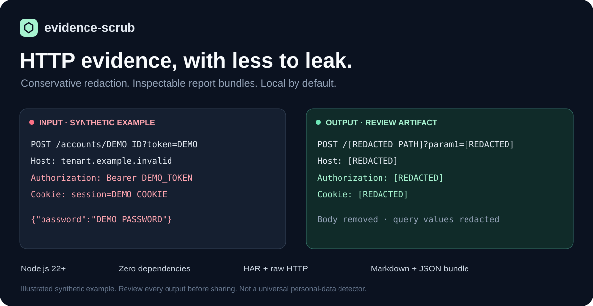

# evidence-scrub



Transforme uma captura HAR ou uma mensagem HTTP em um pacote de evidências que pode ser inspecionado.

**Processamento local por padrão. Sem dependências de pacotes. Ocultação conservadora de dados.**

[English](README.md) · [Segurança](SECURITY.md) · [Como contribuir](CONTRIBUTING.md)

Preparar um relato de bug costuma exigir separar os detalhes úteis do protocolo de credenciais, corpos de mensagens e URLs que identificam pessoas ou sistemas. O `evidence-scrub` cria uma captura com dados ocultados, um relatório Markdown e um resumo estruturado no mesmo diretório.

Revise todos os arquivos antes de compartilhá-los. Esta ferramenta auxilia a ocultação de dados; não detecta todos os dados pessoais nem garante que uma captura possa ser publicada com segurança.

## Comece aqui

Requer **Node.js 22 ou superior**. Execute diretamente do repositório; não é necessário usar `npm install`.

```sh
git clone https://github.com/GabrielGomesAL/evidence-scrub.git
cd evidence-scrub
node bin/evidence-scrub.mjs fixtures/demo.har --out ./clean-demo
```

O exemplo incluído é inteiramente sintético. Abra `clean-demo/report.md` e confira os demais arquivos.

Para uma captura própria, escolha um novo diretório de saída em um local privado:

```sh
node bin/evidence-scrub.mjs /privado/captura.har --out /privado/pacote-para-revisao
```

O diretório de saída não pode existir e seu diretório pai precisa existir. O arquivo original permanece inalterado.

## Um exemplo pequeno

Entrada sintética:

```http
GET https://service.example.invalid/accounts/alice?token=synthetic-token HTTP/1.1
Authorization: Bearer synthetic-secret
Content-Type: application/json

{"private":"synthetic"}
```

Saída HTTP com dados ocultados:

```http
GET https://redacted.invalid/[REDACTED_PATH]?param1=[REDACTED] HTTP/1.1
authorization: [REDACTED]
content-type: application/json
```

O corpo é removido. O relatório gerado também inclui contagens das transformações, informações de procedência e um rascunho de relato para você completar.

## Arquivos gerados

| Arquivo | Finalidade |
| --- | --- |
| `sanitized.har` ou `sanitized.http` | Cópia com dados ocultados no formato detectado |
| `report.md` | Relatório de evidências para leitura |
| `summary.json` | Resumo estruturado para outras ferramentas |
| `github.json` | Metadados públicos do repositório, somente com `--github` |

O relatório identifica a entrada pelo seu resumo SHA-256, sem incluir o nome do arquivo original ou seu caminho no sistema. Esse resumo relaciona o relatório aos bytes exatos da entrada; não comprova a origem nem a autenticidade da captura.

## Política de ocultação de dados

A saída é reconstruída a partir de um conjunto conservador de campos suportados. Campos desconhecidos da captura são omitidos.

| Dado | Tratamento padrão |
| --- | --- |
| Origem de uma URL absoluta | Substituída por `https://redacted.invalid`; alvos HTTP relativos permanecem relativos |
| Caminho da URL | Substituído por `/[REDACTED_PATH]`; a raiz `/` pode permanecer |
| Nomes e valores da query e fragmentos | Ocultados |
| Corpos de requisições e respostas | Removidos |
| Cookies | Arrays de cookies do HAR removidos; valores dos cabeçalhos de cookies ocultados |
| Valores dos cabeçalhos | Ocultados, exceto valores MIME reconhecidos em `Content-Type` |
| Nomes dos cabeçalhos | Nomes conhecidos preservados; desconhecidos descartados |
| Métodos, status e horários suportados | Preservados ou normalizados |
| Estatísticas numéricas suportadas do protocolo | Preservadas |

A saída é uma projeção para revisão, não uma requisição pronta para replay nem uma transcrição sem alterações. Tamanhos de corpos removidos viram `0`; tamanho desconhecido de cabeçalhos vira `-1`; métodos não suportados viram `OTHER`; versões inválidas ficam vazias; status e tempos inválidos usam marcadores `0` ou `-1`. Datas HAR inválidas ou ausentes são rejeitadas. Esses valores descrevem o artefato transformado, e não devem ser apresentados como fatos originais da captura.

### Preserve caminhos quando forem necessários

A estrutura de uma rota pode ajudar a explicar um bug. `--keep-paths` preserva o caminho da URL e mantém as demais ocultações:

```sh
node bin/evidence-scrub.mjs fixtures/demo.har --out ./clean-paths --keep-paths
```

Caminhos podem conter nomes de contas, identificadores, emails ou tokens. Ative essa opção somente após inspecioná-los e decidir que devem permanecer.

### HTTP em texto

O formato HAR ou HTTP é detectado a partir da entrada. O parser HTTP trata uma única requisição ou resposta, sem concatenar uma conversa inteira:

```sh
node bin/evidence-scrub.mjs /privado/requisicao.http --out /privado/http-para-revisao
```

Use `--format har` ou `--format http` para selecionar o parser explicitamente. Execute `node bin/evidence-scrub.mjs --help` para consultar todas as opções.

### Contexto opcional do GitHub

Inclua metadados públicos de um repositório no mesmo pacote:

```sh
node bin/evidence-scrub.mjs fixtures/demo.har --out ./clean-context --github pydantic/pydantic
```

Essa opção consulta a API pública do GitHub para obter os metadados do repositório informado e o SHA do commit de sua branch padrão. Ela envia o nome do proprietário e do repositório; a captura e as evidências geradas não são enviadas. Não é necessário um token do GitHub. A disponibilidade e os limites da API podem afetar essa consulta opcional. Os metadados registram uma revisão pública; não comprovam que a captura tenha sido produzida nessa revisão.

Sem `--github`, o processamento permanece local.

## Limites e revisão

- O limite de arquivos HAR é de **20 MiB**; para HTTP bruto, o limite é de **2 MiB de bytes UTF-8**. Há limites adicionais para registros, cabeçalhos e tamanhos de campos. Entradas de nível superior não suportadas e estruturas acima desses limites são rejeitadas; campos HAR desconhecidos e linhas individuais de cabeçalhos HTTP malformadas podem ser descartados.
- Metadados preservados ainda podem conter informações sensíveis. Revise a captura tratada, o relatório, o resumo e os metadados opcionais antes de compartilhar.
- A opção `--keep-paths` preserva mais informações de forma deliberada.
- Mantenha as capturas originais privadas. Use exemplos sintéticos ao relatar problemas nesta ferramenta.
- O pacote gerado é um ponto de partida para revisão humana; não representa autorização para divulgar evidências.

## Desenvolvimento

```sh
node --test
```

A integração contínua executa os testes no Node.js 22 e 24 com permissão de leitura do repositório. Não há instalação de dependências.

Contribuições úteis incluem exemplos sintéticos para regressão, casos específicos dos formatos, relatórios mais claros e melhorias na ocultação de dados. Consulte [CONTRIBUTING.md](CONTRIBUTING.md).

## Licença e suporte

[MIT](LICENSE) · Gabriel Gomes Almeida

Para bugs comuns, abra uma issue com uma reprodução sintética. Para um problema de segurança, siga [SECURITY.md](SECURITY.md) e escreva em particular para **ggoalmeidaa@gmail.com**.
